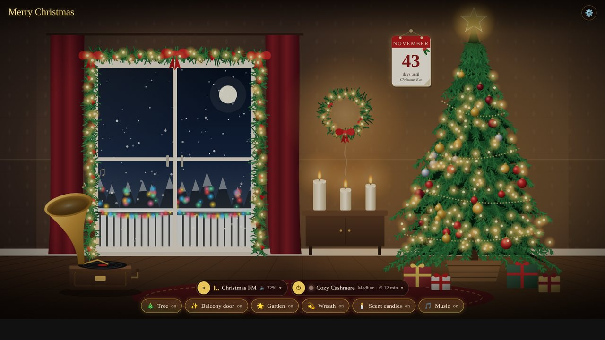
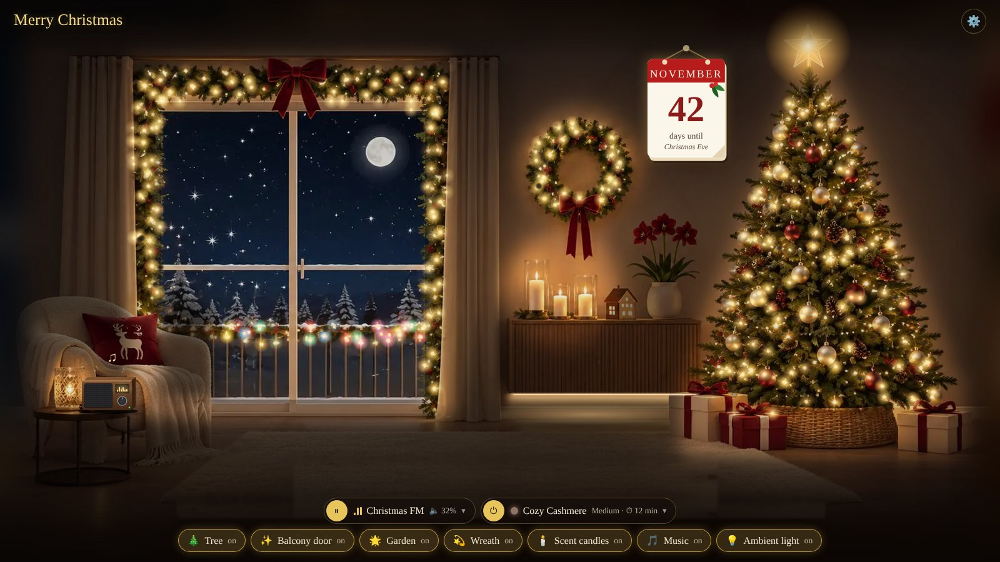
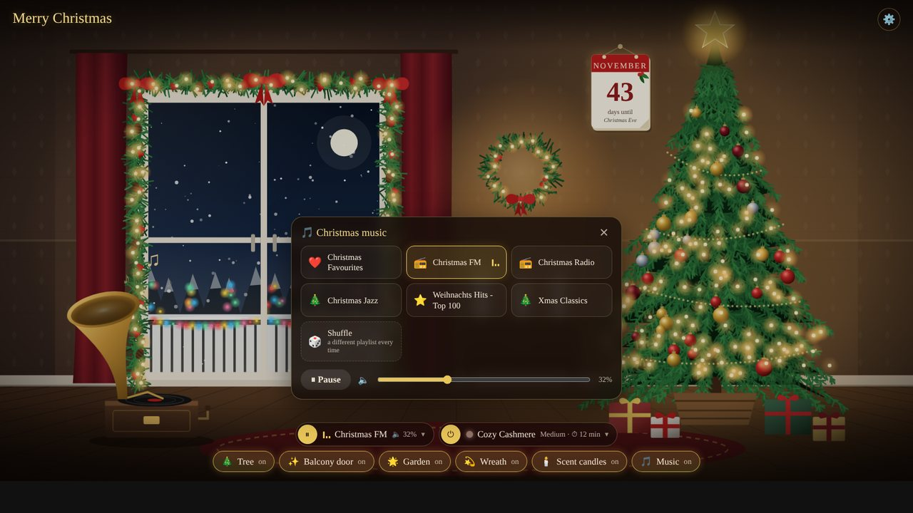
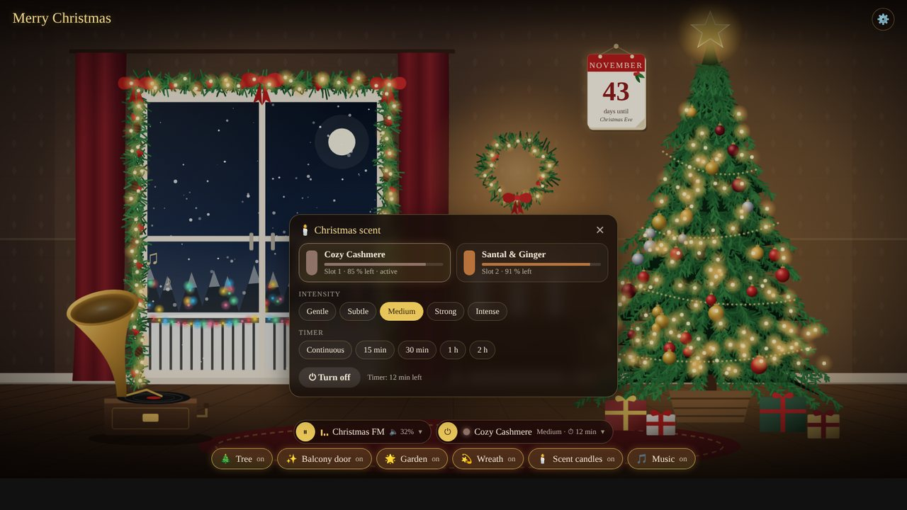
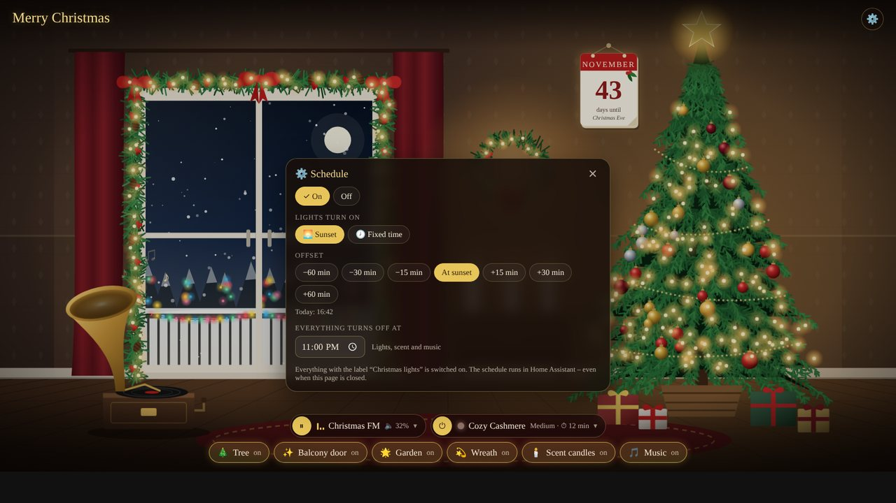
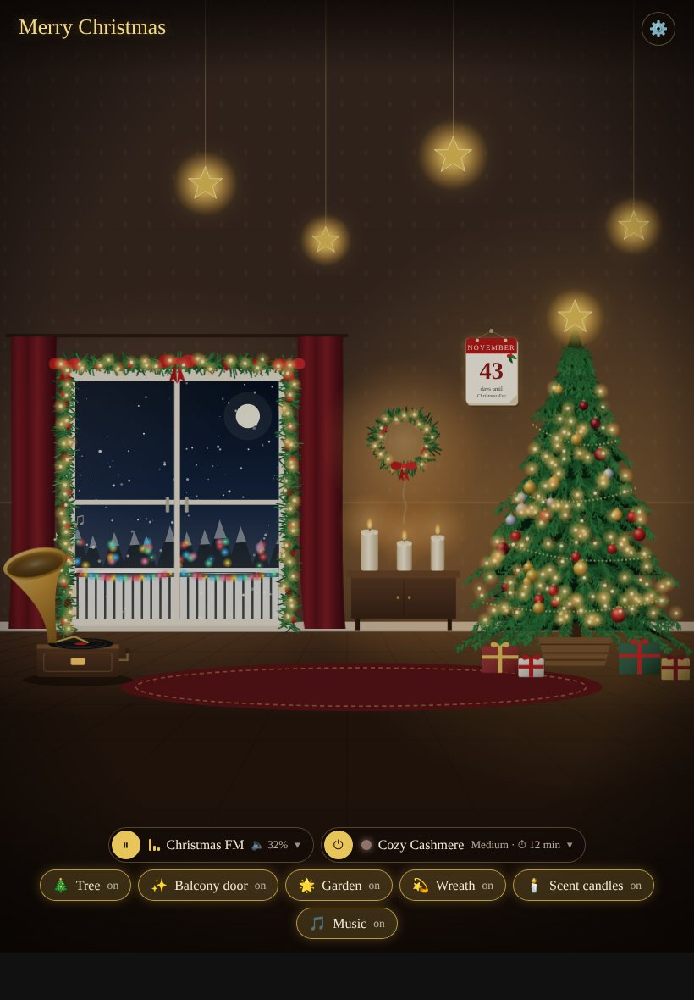

# 🎄 Christmas Room Card

A cosy, animated Christmas living room for your Home Assistant dashboard.
Every object in the room is tappable and runs a real action in your home.

| Classic | Modern |
|---|---|
|  |  |

- **Christmas tree, balcony-door garland, garden lights (seen through the window) and a wreath** – each linked to an entity. The lights twinkle while the entity is on.
- **Scent candles** – switch any entity, or control a **Pura** diffuser directly: both fragrance slots with fill level, intensity and timer.
- **Music** – any `media_player`: up to 6 playlists as tiles – player favourites (e.g. Sonos) **and Spotify, radio stations or Music Assistant playlists** picked with the Home Assistant media browser. Shuffle, play/pause and volume.
- **Schedule** – lights on at sunset (± offset) or at a fixed time, everything off at a set time. Editable right from the card (⚙️).
- **Tear-off calendar** counting down the days until Christmas Eve.
- **Two styles:** *classic* (illustrated, pure SVG) and *modern* (photo-realistic room where every lit area dims and lights up with its entity – or use your own background photo).
- Full-screen, adapts to landscape and portrait (tablet, phone, wall panel).
- Visual editor, German 🇩🇪 and English 🇬🇧 (follows your Home Assistant language).
- Self-contained JavaScript – no external dependencies.

| Music | Scent (Pura) | Schedule |
|---|---|---|
|  |  |  |



---

## Installation

### Marketplace / HACS (custom repository)

[](https://my.home-assistant.io/redirect/hacs_repository/?owner=Severinius-MUC&repository=christmas-room-card&category=plugin)

One click opens the card in your Home Assistant (Marketplace from 2026.11, HACS before) – or add it manually:


1. Open **Settings → Marketplace** (HACS on Home Assistant 2026.10 and older).
2. Choose **Add from link** (HACS: ⋮ → *Custom repositories*, category *Dashboard*) and enter
   `https://github.com/Severinius-MUC/christmas-room-card`
3. Install **Christmas Room Card** and reload the browser.

### Manual

1. Download `christmas-room-card.js` from the [latest release](https://github.com/Severinius-MUC/christmas-room-card/releases/latest) into `config/www/`.
2. **Settings → Dashboards → ⋮ → Resources → Add resource**: URL `/local/christmas-room-card.js`, type *JavaScript module*.
3. Reload the browser.

---

## Usage

The card looks best in a view of type **Panel** (one card, full screen). Add the card via the card picker ("Christmas Room Card") and configure everything in the visual editor – or use YAML:

```yaml
type: custom:christmas-room-card
style: modern                     # classic (default) or modern
title: Merry Christmas            # optional, default depends on language
tree:
  entity: switch.christmas_tree
door:
  entity: switch.balcony_garland
garden:
  entity: light.garden_lights
wreath:
  entity: switch.wreath
candles:
  entity: select.living_room_diffuser_fragrance
  pura_device: 0123456789abcdef0123456789abcdef   # optional, enables the Pura panel
  default_timer: 15
  default_intensity: medium
music:
  entity: media_player.living_room
  on_states: [playing]
  random: true
  sources:                          # optional: player favourites/sources (Sonos favourites)
    - Christmas FM
  playlists:                        # optional: anything from the media browser
    - name: Spotify Christmas Hits
      media:
        entity_id: media_player.living_room
        media_content_id: spotify:playlist:37i9dQZF1DX0Yxoavh5qJV
        media_content_type: playlist
    - name: Christmas Radio
      media:
        entity_id: media_player.living_room
        media_content_id: media-source://radio_browser/<station-uuid>
        media_content_type: audio/mpeg
schedule:                           # optional, see below
  enabled: input_boolean.xmas_schedule
  start_mode: input_select.xmas_start_mode
  start_offset: input_number.xmas_start_offset
  start_time: input_datetime.xmas_start_time
  end_time: input_datetime.xmas_end_time
  label: Christmas lights
```

### Options

| Option | Description |
|---|---|
| `title` | Heading. Default: "Merry Christmas" / "Frohe Weihnachten". |
| `language` | `de` or `en`. Default: language of Home Assistant. |
| `style` | `classic` (illustrated, default) or `modern` (photo). In the modern style everything starts dimmed; each switched-on object lights up its own area of the photo and twinkles. |
| `background_image` | Modern style only: URL of your own 16:9 photo (e.g. `/local/my-room.jpg`). The tap areas are made for the bundled picture, so your photo should have a similar layout. |
| `fit` | `auto` (default – always shows the whole room and extends wall/floor to fill the screen), `cover`, `contain`. |
| `height` | Card height. Default: full screen below the header. `auto` = fixed 5:3 aspect ratio (for normal dashboards). |
| `show_chips` | Show the buttons at the bottom (default `true`). |
| `tree`, `door`, `garden`, `wreath`, `candles`, `music` | One object each, see below. |
| `ceiling` | Modern style: pendant ceiling light – when on, the whole room is bright (follows the light's `brightness`). The button is always shown in the modern style; without an `entity` it is a pure display toggle. |
| `sideboard` | Modern style: indirect LED light under the sideboard. With an `entity` it gets its own button and takes the light's colour (`rgb_color`); without one it simply follows the tree. |
| `schedule` | Helpers for the schedule panel, see below. |

**Per object** (`tree`, `door`, `garden`, `wreath`, `candles`, `music`):

| Key | Description |
|---|---|
| `entity` | Entity whose state drives the visuals (lights twinkle while it is on). |
| `action` | Optional `script.*`, `scene.*` or `automation.*` to run on tap. Without it the entity is switched on/off. |
| `on_states` | Optional list of states that count as "on" (default: everything except off, idle, paused, unavailable …). |
| `name` | Optional label for the button. |

**Music** (when `entity` is a `media_player`): `controls` (panel on/off), `sources` (player favourites/sources, default: all sources containing *Christmas / Weihnacht / Xmas / Advent …*), `playlists` (own media, see below), `random` (shuffle tile). Favourites and playlists together show at most 6 tiles.

**Own playlists (Spotify, radio, Music Assistant):** in the editor, open *Music → Own playlists* and add an entry. Pick a player and browse to the playlist, station or album with the Home Assistant media browser – e.g. *Spotify*, *Radio Browser* or the *Music Assistant* library (choose the Music Assistant player of your speaker). The card plays it with `media_player.play_media` on that player. Play/pause, volume and the visuals still follow the main `entity`.

**Scent candles with Pura**: set `pura_device` to the device of the [Pura integration](https://github.com/natekspencer/hacs-pura). The card finds the fragrance and intensity selects, slot sensors and timer itself. Options: `timers` (list of minutes, `0` = continuous), `default_timer`, `default_intensity` (`gentle`, `subtle`, `medium`, `strong`, `intense`).

---

## Schedule (optional)

The schedule runs in Home Assistant – it also works when no dashboard is open. The card only provides the settings panel (⚙️).

1. **Create helpers** (Settings → Devices & services → Helpers):
   - Toggle `input_boolean.xmas_schedule`
   - Dropdown `input_select.xmas_start_mode` with the options `sunset` and `time`
   - Number `input_number.xmas_start_offset` (−120 … 120, step 5, unit min)
   - Date/time `input_datetime.xmas_start_time` and `input_datetime.xmas_end_time` (time only)
2. **Create a label**, e.g. "Christmas lights", and assign it to every entity that should switch on with the schedule.
3. **Import the blueprint** and create an automation from it:

   [](https://my.home-assistant.io/redirect/blueprint_import/?blueprint_url=https%3A%2F%2Fgithub.com%2FSeverinius-MUC%2Fchristmas-room-card%2Fblob%2Fmain%2Fblueprints%2Fautomation%2Fchristmas_room_schedule.yaml)

4. Add the helpers under `schedule:` in the card – the ⚙️ button appears.

---

## 🇩🇪 Deutsch

Ein gemütliches, animiertes Weihnachts-Wohnzimmer fürs Dashboard. Jedes Objekt ist antippbar und schaltet etwas in deinem Zuhause: **Baum, Girlande an der Balkontür, Gartenbeleuchtung im Fenster, Kranz, Duftkerzen** (beliebige Entität oder direkt ein **Pura**-Duftspender mit Slots, Intensität und Timer) und **Musik** (jeder Media-Player – bis zu 6 Playlists aus Sonos-Favoriten, **Spotify, Radio oder Music Assistant** über die Medienauswahl, Zufall, Lautstärke). Dazu ein **Abreißkalender** als Countdown bis Heiligabend und ein **Zeitplan** (Lichter bei Sonnenuntergang ± Versatz oder zu fester Uhrzeit an, alles zu einer Endzeit aus), der direkt in der Karte über ⚙️ eingestellt wird.


**Stil:** `style: classic` (gezeichnet, Standard) oder `style: modern` (Foto – jedes eingeschaltete Objekt leuchtet in seinem Bereich auf, die Lichterketten blinken, alles andere bleibt gedimmt; Musik kommt aus dem Smart-Radio neben dem Sessel). Optional `ceiling: { entity: light.… }` für das Deckenlicht (macht den ganzen Raum hell, folgt der Helligkeit) und `sideboard: { entity: light.… }` für die indirekte Beleuchtung unter dem Sideboard – übernimmt die Farbe des Lichts.

**Installation:** *Einstellungen → Marketplace → Add from link* → `https://github.com/Severinius-MUC/christmas-room-card` (oder manuell wie oben beschrieben). Danach am besten eine Ansicht vom Typ **Panel** anlegen und die Karte „Christmas Room Card“ hinzufügen – alles Weitere im grafischen Editor.

**Zeitplan:** Helfer anlegen (Schalter, Dropdown mit `Sonnenuntergang` und `Uhrzeit` – oder `sunset`/`time`, Zahl für den Versatz, zwei Zeit-Helfer), ein Label wie „Weihnachtslicht“ an alle Lichter vergeben, den Blueprint oben importieren und die Helfer in der Karte unter „Zeitplan“ eintragen. Die Karte ist zweisprachig und folgt der Sprache von Home Assistant (Option `language: de` erzwingt Deutsch).

---

Made with ❤️ and Home Assistant · MIT License
